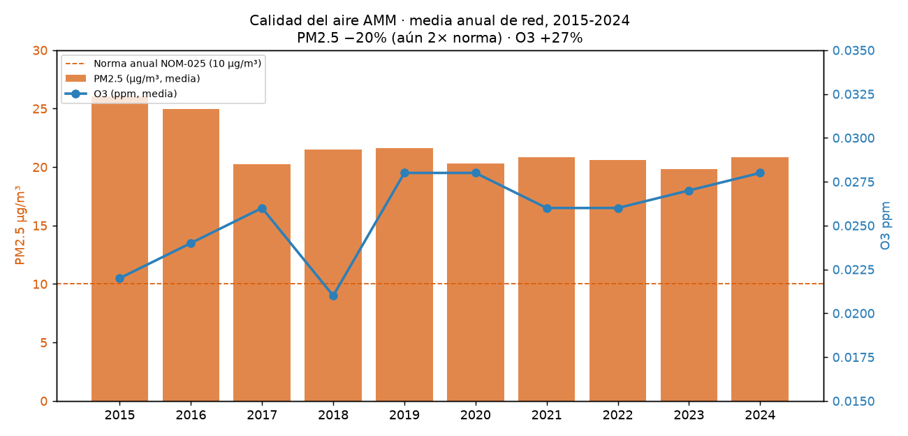
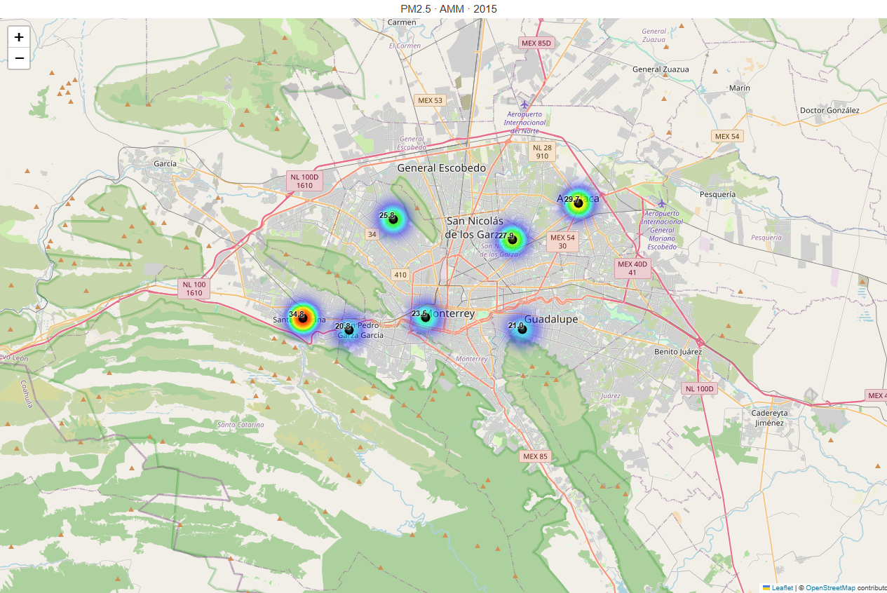
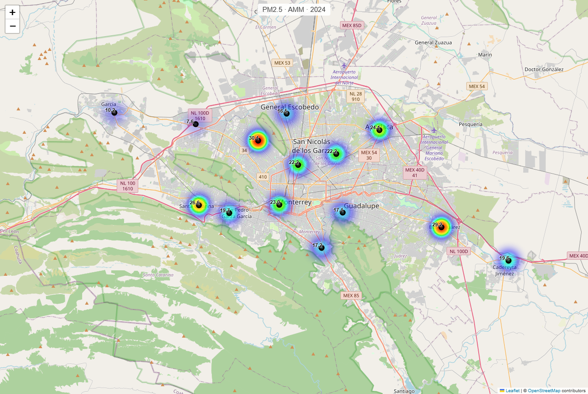
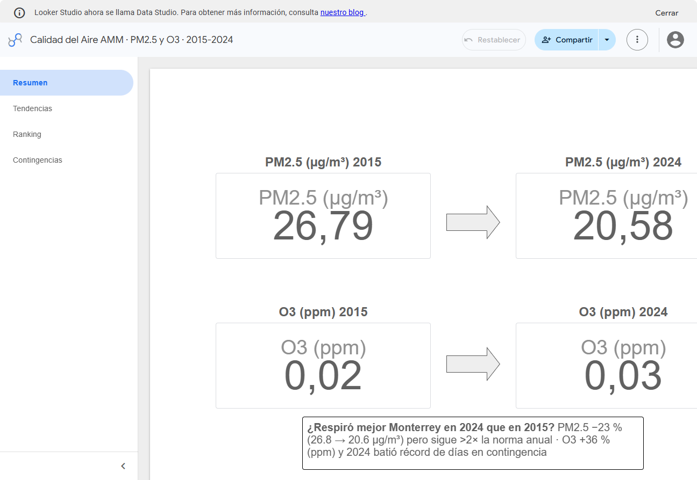
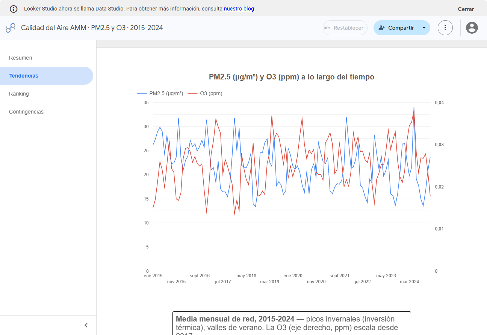
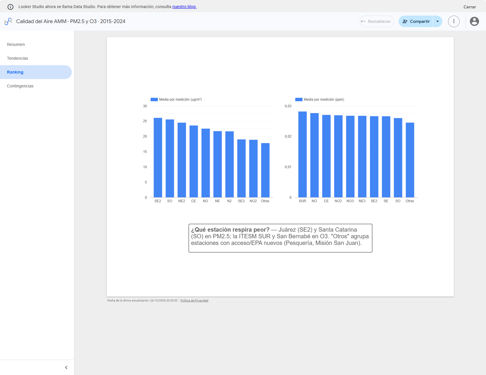
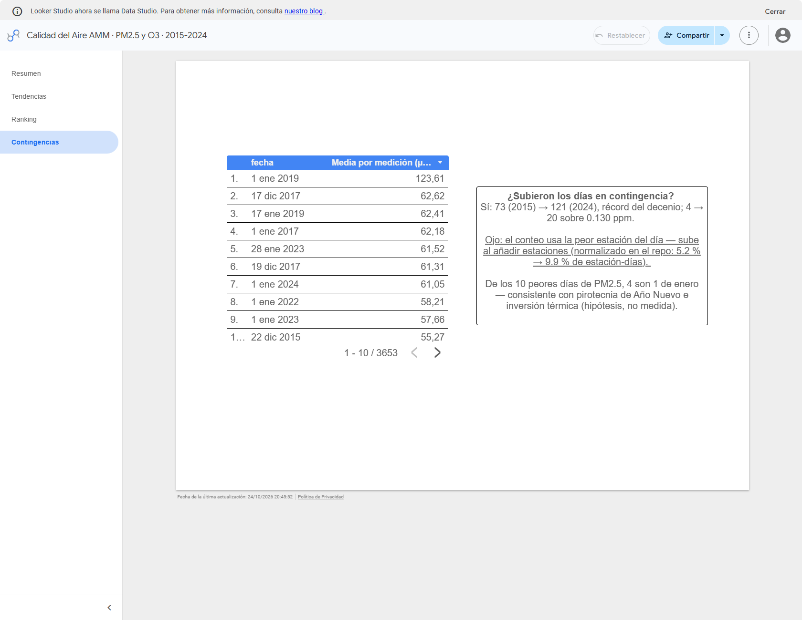

# aire-monterrey-bigquery

[](https://github.com/MVillarreal98/aire-monterrey-bigquery/actions/workflows/tests.yml)

**¿Respiró mejor Monterrey en 2024 que en 2015?** Análisis de calidad del aire del Área
Metropolitana de Monterrey (AMM) con ~1.5 M mediciones horarias validadas de O3 y PM2.5
(15 estaciones de la red SIMA, 2015-2024), descargadas de SINAICA/INECC y cargadas en
**Google BigQuery**.

Proyecto personal de análisis (octubre de 2026), desarrollado con asistencia de
herramientas de IA (ver [Cómo se construyó](#cómo-se-construyó)).

## Preguntas de negocio

1. **PM2.5 y ozono:** ¿mejoró la calidad del aire de Monterrey entre 2015 y 2024?
Entre 2015 y 2024, Monterrey mostró avances en la reducción de partículas finas, pero no una mejora generalizada de la calidad del aire. Aunque el promedio de PM2.5 disminuyó un 20%, el ozono aumentó un 29.2%.
Al comparar seis estaciones que estuvieron presentes durante el periodo, la reducción de PM2.5 fue menor, del 14.1%. Esto sugiere que parte de la mejora observada puede estar relacionada con los cambios en las estaciones que reportaron información.

En conclusión, hay señales de progreso en un contaminante, pero el ozono sigue siendo un problema que merece atención.
2. **¿Qué estación respira peor?** San Pedro vs Apodaca vs Centro, y el ranking completo.
El nivel de contaminación no es igual en toda el área metropolitana. Para identificar qué estación presenta las peores condiciones, comparamos las concentraciones registradas en San Pedro, Apodaca, Centro y el resto de las estaciones.

El ranking permite detectar dónde se registran mayores concentraciones de contaminantes, pero una estación con valores elevados no significa necesariamente que todo el municipio tenga la misma calidad del aire.
3. **Días de contingencia:** serie anual de días sobre norma y mapa de las estaciones.
Analizamos la evolución anual de los días en los que las mediciones superaron los límites establecidos para los contaminantes estudiados. La serie permite observar si los episodios de contaminación se han vuelto más o menos frecuentes y qué estaciones registran más superaciones.

El mapa ayuda a identificar las zonas donde se concentran estos episodios y facilita comparar los patrones entre estaciones.

## Respuestas cortas (con sus límites)

1. **PM2.5 bajó y el ozono subió, pero la red cambió entre los dos años.** Con la red
   completa, la media anual de PM2.5 pasa de 26.1 a 20.8 µg/m³ (−20 %, query 2C). En 2015
   solo 7 estaciones midieron PM2.5 y en 2024 fueron 14, varias con medias bajas, así que
   parte de ese −20 % se debe a la composición de la red. Con un panel fijo de 6 estaciones
   con 183 días o más medidos en ambos años, el cambio es −14.1 % (25.7 → 22.1, query 2D).
   El O3 pasa de 21.6 a 27.9 ppb (+29.2 %, query 2C, sin redondeo intermedio); con panel
   fijo de 8 estaciones, +36.8 %. Detalles en
   [`docs/resultados_2015_2024.md`](docs/resultados_2015_2024.md).
2. **Apodaca (NE2) 24.5 µg/m³, 3.ª de 14; Centro/Obispado (CE) 23.4, 4.ª; San Pedro (SO2) 18.6,
   10.ª** (media de PM2.5 en 2015-2024). La más alta es Juárez (SE2) con 26.0, pero tiene
   solo 429 días medidos en 2015-2019, contra 1,689 en 2020-2024.
3. **Días de O3 sobre norma: 73 (2015) → 121 (2024).** El conteo usa la peor estación de la
   red cada día, así que sube solo con añadir estaciones. La query 4C lo normaliza por
   estación-día: 5.2 % de los estación-días en 2015 frente a 9.9 % en 2024.

Las queries 2C (sin redondeo intermedio), 2D (panel fijo de estaciones) y 4C (O3
normalizado) están en `sql/` y ya se ejecutaron; sus resultados están en
`outputs/02_tendencia_anualc.csv`, `outputs/02_tendencia_anuald.csv` y
`outputs/04_contingenciasc.csv`.

## Stack

| Capa | Tecnología |
|---|---|
| Ingesta | Python + requests → endpoint público de SINAICA/INECC (datos de la red SIMA) |
| Almacén | BigQuery: tabla particionada por fecha y clusterizada por estación y contaminante |
| Transformación | SQL de BigQuery con CTEs, agregación diaria → anual, `COUNTIF` y `APPROX_QUANTILES` sobre 1.5 M mediciones horarias |
| Visualización | Matplotlib, Folium (mapa de estaciones) y un dashboard de **Looker Studio** |

## Estructura

```
aire-monterrey-bigquery/
├── sql/                 # DDL de la tabla (01) y 4 archivos de SQL analítico (02-05)
├── src/
│   ├── download/        # descarga de SINAICA (sinaica_download.py) y parquet (build_parquet.py)
│   ├── analysis/        # run_queries.py: ejecuta sql/02-05 y guarda CSV en outputs/
│   └── viz/             # figuras matplotlib (charts.py) y mapas folium (heatmap_folium.py)
├── outputs/             # resultados commiteados: CSV de las queries y mapas HTML
├── data/
│   ├── raw/             # JSONL descargados (no se versionan)
│   └── processed/       # parquet listo para BigQuery (no se versiona)
├── dashboards/          # spec del dashboard de Looker Studio
├── docs/                # API de SINAICA, setup de GCP, estaciones, resultados y figuras PNG
└── tests/               # 5 tests unitarios de la ingesta (sin BigQuery)
```

## Reproducir

Probado en Windows 10 con Python 3.12; las versiones están fijadas en `requirements.txt`.
Los pasos 3 y 4 necesitan un proyecto de GCP propio (ver [`docs/gcp_setup.md`](docs/gcp_setup.md)).

```powershell
# 0. Entorno
python -m venv .venv
.venv\Scripts\Activate.ps1          # bash: source .venv/Scripts/activate (Windows) o .venv/bin/activate
pip install -r requirements.txt
python -m pytest tests -v           # 5 tests de ingesta; no usan la red ni BigQuery

# 1. Descarga (3,360 peticiones a 1.1 s o más cada una: una hora o más)
python src/download/sinaica_download.py

# 2. Parquet tipado y deduplicado
python src/download/build_parquet.py

# 3. Carga a BigQuery y, justo después, el ALTER TABLE que quita la expiración de
#    particiones (comando completo y motivo en sql/01 y docs/gcp_setup.md)
bq load --source_format=PARQUET --time_partitioning_field=fecha --clustering_fields=estacion,param --replace aire-monterrey-bq:sima.sima_horarios data/processed/sima_horarios.parquet

# 4. Queries de negocio → outputs/*.csv
python src/analysis/run_queries.py

# 5. Figuras (solo leen outputs/*.csv) y mapas (leen el parquet local)
python src/viz/charts.py
python src/viz/heatmap_folium.py --year 2015
python src/viz/heatmap_folium.py --year 2024
python src/viz/heatmap_folium.py
```

`run_queries.py` usa el proyecto `aire-monterrey-bq`; para usar otro, define la variable de
entorno `AIRE_GCP_PROJECT`. Los CSV y los mapas HTML de la última corrida están commiteados
en `outputs/`, así que las cifras se pueden revisar y las figuras regenerar sin acceso a
BigQuery. Los PNG de los mapas (`docs/img/heatmap_*.png`) son capturas a 1280×860 de esos
HTML en un navegador sin interfaz (por ejemplo, `msedge --headless=new --screenshot`).

## Evidencias

**Tendencia anual de la red completa** (sin corregir el cambio de composición de la red):



**PM2.5 por estación, 2015 (7 estaciones) vs 2024 (14 estaciones).** Cada mapa se normaliza
contra su propio máximo, así que los colores **no** se pueden comparar entre los dos mapas:
compara los números de cada estación. Los puntos son estaciones y el color no interpola
entre ellas. San Bernabé (NO, 30.1 en 2024) solo tiene 86 días medidos ese año.

| 2015 | 2024 |
|---|---|
|  |  |

El resto de la evidencia (O3 2024, media decenal, ranking, días sobre norma y peores días)
está en [`docs/resultados_2015_2024.md`](docs/resultados_2015_2024.md) y en `docs/img/`.

**Dashboard:** [Looker Studio](https://datastudio.google.com/reporting/fe47cccc-d1c9-4392-97d0-605069f4096c),
con 4 páginas: resumen 2015 vs 2024, tendencias mensuales, ranking por estación y top 10 días
de PM2.5. Se conecta en vivo a la tabla de BigQuery: si la tabla expira o se borra, el
dashboard se queda sin datos (ver [`docs/gcp_setup.md`](docs/gcp_setup.md)).

Capturas del 24-oct-2026, para que la evidencia no dependa de que la tabla siga existiendo:

| Resumen | Tendencias |
|---|---|
|  |  |
|  |  |

Diferencia conocida (capturas vs repo): los scorecards del reporte promedian por fila
horaria (26.79 → 20.58 µg/m³, −23 %), mientras el repo usa media diaria → anual (−20 %,
query 2C) y panel fijo (−14.1 %, query 2D); la metodología queda etiquetada en el propio
reporte ("media por medición"), y los cuadros de texto citan las cifras del repo y marcan
las causas como hipótesis. Detalle en
[`dashboards/looker_studio_spec.md`](dashboards/looker_studio_spec.md).

## Fuente de datos y atribución

- **Datos:** Sistema Nacional de Información de la Calidad del Aire (SINAICA), del
  INECC/SEMARNAT, con las mediciones de la red SIMA del Gobierno de Nuevo León. Se
  descargaron en octubre de 2026 con el filtro de datos validados, desde el endpoint que usa
  el portal público <https://sinaica.inecc.gob.mx>, a una petición cada 1.1 s. No es una API
  oficial documentada (ver [`docs/sinaica_api.md`](docs/sinaica_api.md)).
- **Términos y normas:** los valores normativos del repo son los de la NOM-025-SSA1-2021
  (PM2.5; DOF 27/10/2021, <https://dof.gob.mx/nota_detalle.php?codigo=5633855>) y la
  NOM-020-SSA1-2021 (O3; DOF 28/10/2021, <https://dof.gob.mx/nota_detalle.php?codigo=5633956>),
  aplicados como umbral constante a todo el periodo; el calendario gradual oficial lo
  mantiene SINAICA en <https://sinaica.inecc.gob.mx/pags/noms.php>. El portal es un sitio de
  gob.mx: el uso de su información pública se rige por sus términos
  (<https://www.gob.mx/terminos>) y los datos abiertos por la Política de Libre Uso MX, que
  exige atribución — se cumple citando la fuente.
- **Qué se publica:** solo agregados derivados (`outputs/*.csv`, figuras y mapas). Los datos
  crudos y el parquet no se redistribuyen.
- **Mapas base:** © OpenStreetMap contributors (ODbL).
- **Licencia:** el código de este repositorio es MIT ([`LICENSE`](LICENSE)). Los datos y sus
  derivados conservan los términos de su fuente (SINAICA/INECC); la licencia MIT no se
  extiende a ellos.

## Limitaciones

- **Composición de la red:** se suman estaciones en 2017 (Cadereyta, UANL, ITESM Sur), 2020
  (Pesquería) y 2022 (Misión San Juan), y la cobertura por estación y año varía mucho
  (`outputs/02_tendencia_anualb.csv`). Las medias de red y los conteos que usan la peor
  estación del día dependen de qué estaciones midieron.
- **Sin criterio de suficiencia diaria:** un día con pocas horas válidas cuenta como media
  diaria completa, cuando la práctica normativa pide al menos 75 % de las horas. El top 10 de
  días incluye el 1-ene-2017, con una sola estación midiendo.
- **Normas:** se aplican los valores de la NOM-025-SSA1-2021 (PM2.5) y la NOM-020-SSA1-2021
  (O3) como umbral constante a todo 2015-2024, aunque antes de 2021 regían otros valores; el
  límite de 24 h de PM2.5 que se usa (41 µg/m³) es el de "año 1" de la norma gradual — el de
  "año 3" (vigente en 2024-2025) es 33 µg/m³. Enlaces al DOF en "Fuente de datos y
  atribución". Los umbrales de "contingencia probable" (97 µg/m³ y 0.130 ppm) los fijó el
  autor como referencia; no son las declaraciones oficiales del programa de contingencias.
- **Outliers:** hay lecturas de 991 µg/m³ y de −1, y no se aplicó enmascaramiento por evento.
- **Diseño de la tabla:** con unas 415 filas por día, la partición diaria no ahorra costo con
  este volumen, y las queries de `sql/02-05` no filtran por fecha, así que no hay poda real:
  medido con `bq query --dry_run` (25/10/2026), la serie anual completa (2A) procesa 44.6 MB
  y con filtro de un solo año, 6.3 MB — la poda existe, pero solo si la query filtra por
  fecha. Se dejó la partición diaria para practicar el patrón.
- **Atribuciones causales** (pirotecnia, industria, inversión térmica): son hipótesis
  consistentes con los datos, no resultados medidos.

## Cómo se construyó

Desarrollado con asistencia de herramientas de IA. Los commits `fix: review …` del historial
corresponden a rondas de revisión del código y de las afirmaciones de los documentos,
también asistidas por IA. Los 5 tests de `tests/test_pipeline.py` cubren solo los helpers de
ingesta (codificación del nombre de archivo, meses y deduplicación). El workflow
`.github/workflows/tests.yml` se ejecuta en GitHub Actions en cada push
a `main` y en cada pull request. El SQL y las figuras no tienen tests automatizados.
